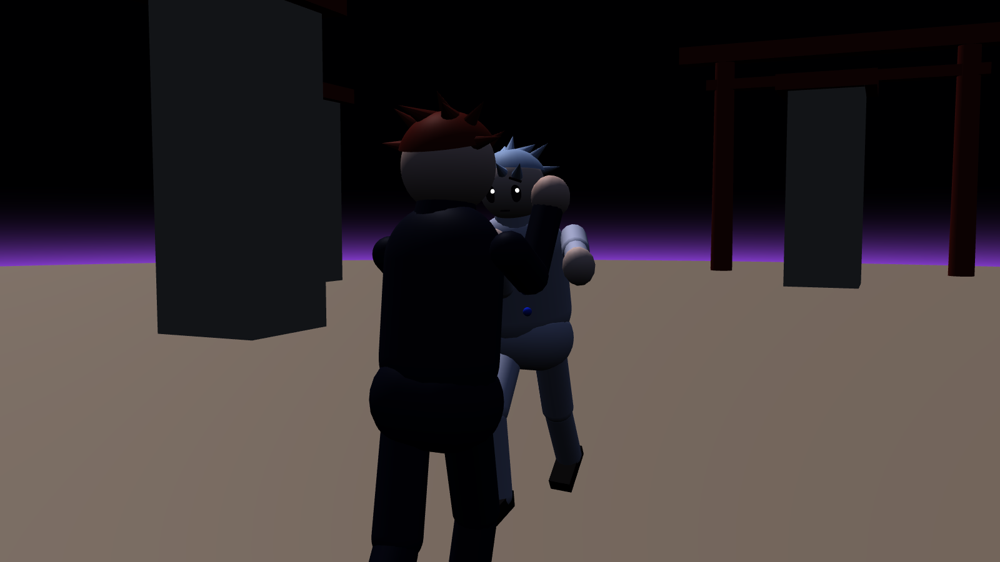
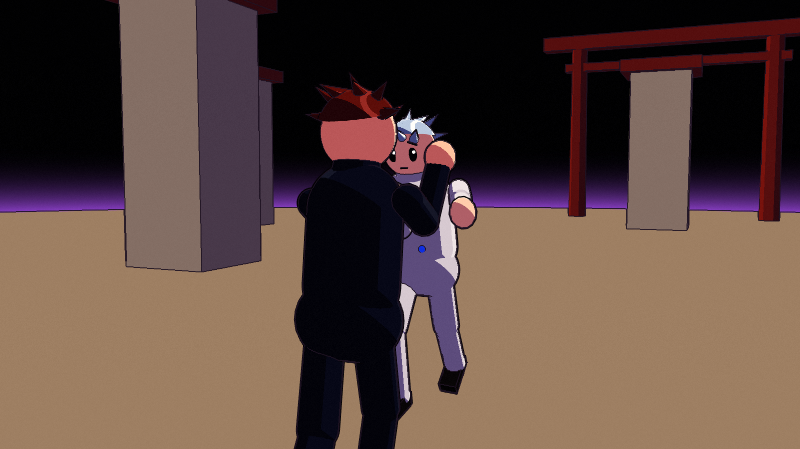
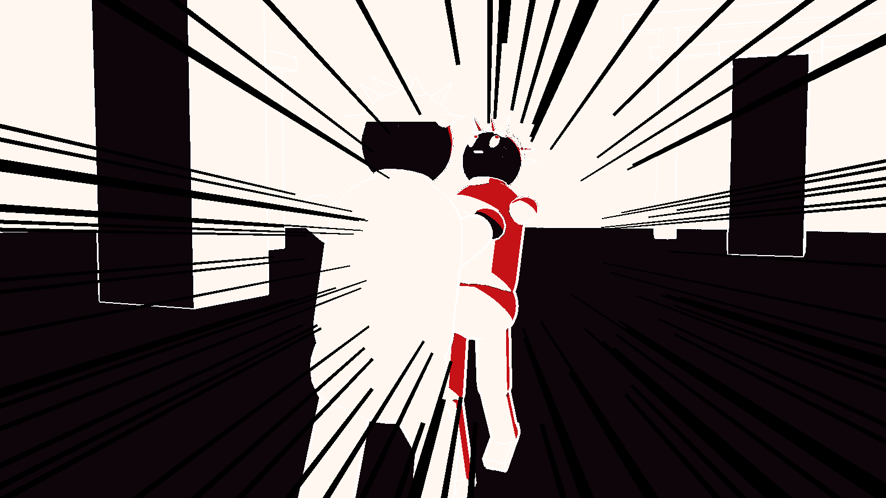

# Recherche: 3D, das wie ein 2D-Anime aussieht

Ziel: Pausiert man irgendwann, soll das Bild wie ein Key-Frame aus einem Top-Anime aussehen.
Das Leitprinzip stammt aus dem bekanntesten Beispiel dafür, Guilty Gear Xrd (Arc System Works, GDC 2015):
**„Kill everything 3D“**. Alles, was nach 3D aussieht, wird entfernt oder überschrieben.

## Was es „3D“ aussehen lässt (und was wir dagegen tun)

| Verräter | Gegenmittel |
|---|---|
| Weiche Licht-Verläufe, Specular, PBR | Harte 2–3 Tonstufen, keine Glanzlichter außer gemalten |
| Schatten, die physikalisch korrekt über das Gesicht wandern | Schatten **gesteuert** statt berechnet: bearbeitete Vertex-Normalen + Schatten-Masken, Gesicht per SDF-Shadow-Map |
| Flüssige 60-fps-Animation | **Limited Animation**: Posen auf 2s/3s gehalten, keine Interpolation |
| Starre Proportionen aus jeder Perspektive | Modell wird pro Pose/Shot verformt (Faust größer, Arm länger) |
| Unscharfe TAA-Kanten, Motion Blur, Tiefenunschärfe | FXAA oder MSAA, kein Motion Blur, keine DoF außer gezielt |
| Ambient Occlusion, Global Illumination | aus. Licht pro Charakter, nicht aus der Szene |
| Texturdetails, die beim Zoomen matschen | Details in **Vertex-Daten** statt Texturen (Vertex-Color, Normalen, UVs) |

## 1. Shading

- **Charakter-eigenes Licht:** Jeder Charakter bekommt seine eigene Lichtrichtung (Material Parameter
  Collection), unabhängig von der Stage. Dadurch sind Gesichter immer gut ausgeleuchtet. Guilty Gear Xrd
  macht genau das.
- **2–3 Tonstufen** über eine Ramp-Textur oder einen harten Schwellwert auf N·L.
- **Schatten-Kontrolle per Vertex:**
  - Vertex-Normalen im Gesicht und an Kleidung werden von Hand gerichtet, damit Schatten saubere Formen bilden.
  - Vertex-Color (oder eine „ILM“-Maske) legt fest, wo Schatten leichter oder schwerer entsteht.
  - Xrd hat Details bewusst in Vertex-Daten statt in Texturen gelegt, weil Texturen beim Zoomen auflösungsabhängig werden.
- **Gesicht per SDF-Shadow-Map:**
  - Eine Graustufen-Textur (aus Schatten-Zeichnungen per SDF berechnet) sagt pro Lichtwinkel, wo der Schatten liegt.
  - Der Schatten wandert dadurch sauber und in „gezeichneten“ Formen über das Gesicht.
  - Der Shader braucht Vorwärts- und Rechts-Vektor des Kopfes.
  - So arbeiten auch Genshin-artige Shader.
- **Rim-Light** als feste, schmale Kante statt Fresnel-Verlauf.

## 2. Linien

- **Außenlinien Charakter:**
  - Inverted Hull: Ein zweites, leicht aufgeblasenes Mesh mit Front-Face-Culling.
  - Die Liniendicke kommt aus Vertex-Color, dadurch dünner an Spitzen und dicker an Silhouetten.
  - Liefert die schönsten Linien und ist billig.
- **Innenlinien:**
  - Werden in die Textur gemalt, entlang von UV-Kanten ausgerichtet („Motomura-Linien“).
  - Bleiben dadurch auch in Nahaufnahmen scharf.
- **Umgebung:** Post-Process-Linien per Sobel-Filter auf Tiefe und Normalen (eine Material-Pass, global).

## 3. Animation

- **Stepped Playback:** Animationen mit Step-Interpolation abspielen (Unreal: Interpolation „Step“ auf der
  Anim-Sequenz) bzw. auf 12/8 fps sampeln. Die Simulation läuft weiter mit 60 Hz, nur die Optik springt.
  Xrd hat volle Animation getestet und verworfen, weil es sofort wieder nach 3D aussah.
- **Pro Key verformen:** Morph-Targets oder Zusatzknochen für übertriebene Posen, Smear-Frames und
  Mehrfach-Gliedmaßen bei schnellen Schlägen.
- **Hitstop** kommt schon aus der Simulation und passt perfekt zum Anime-Timing.

## 4. Kamera & Effekte

- Verfolger-Kamera mit moderatem FOV. Bei Max Output und Realm Expansion übernehmen **Cinematic-Kameras**
  mit niedrigem FOV (~25–30°), Dutch Angles und harten Schnitten.
- **Impact-Frames:** 2–4 Frames invertiertes Schwarz-Weiß-Bild mit dicken Tuschelinien (Post-Process:
  Luminanz invertieren + Schwellwert + Linien verstärken). Ausgelöst durch die Events `BlackSpark`, `WallBreak`
  und Crushing-Treffer, die die Simulation schon liefert.
- **VFX handgezeichnet:** Flipbooks und cel-shaded Meshes statt realistischer Partikel. Staub als
  Toon-Wolken mit Outline. Speedlines als Screen-Overlay.

## 5. Umgebung & Farbe

- Gemalt wirkende Texturen, vereinfachte Formen, Farbverlauf statt Nebel.
- Color-Grading pro Kolonie, leichtes Film-Grain.
- Die **Barriere** ist reines Unlit-Schwarz und dadurch automatisch „2D“.

## Umsetzung in Unreal: drei Wege

| Weg | Wie | + | − |
|---|---|---|---|
| A. Post-Process-Toon | Globale Toon- und Outline-Pässe auf das normale Bild (viele fertige Pakete) | schnell, keine Asset-Arbeit | wenig Kontrolle über Gesichter und Schatten, sieht schnell nach Filter aus |
| B. Eigenes Shading-Model | Engine-Fork: neue Shading-Model-ID, GBuffer und Lighting-Shader ändern | maximale Kontrolle, echtes Licht | Engine-Fork pflegen, Konflikte mit Lumen/VSM, Spezialwissen |
| **C. Unlit + eigenes Licht** (Empfehlung) | Charakter-Materialien sind Unlit und rechnen Toon-Licht selbst (MPC-Lichtrichtung, Ramp, Vertex-Masken, SDF-Gesicht). Outlines per Inverted Hull | volle Kontrolle wie in Xrd, **sehr billig** (Handheld!), kein Engine-Fork | Schattenwurf der Umgebung auf Charaktere muss gefaked werden (passt aber zum Anime) |

**Empfehlung:**
- **Charaktere:** Weg **C**.
- **Umgebung:** normal beleuchtet plus Post-Process-Quantisierung und Sobel-Linien (Weg A, nur für die Umgebung).
- **Engine-Fork (B):** nur, falls wir später Lumen o. ä. brauchen, was für den Look nicht nötig ist.
- **Fertiger UE-Toon-Shader:** Ein Hersteller-Blog spricht von einem neuen Substrate-basierten Toon-Shader
  in UE 5.8. Das ist nicht offiziell bestätigt, im Auge behalten.

## Prototyp-Plan

1. **Toon-Master-Material** (Unlit, MPC-Licht, Ramp, Vertex-Color-Schattenmaske) an einem Testmodell
2. **Inverted-Hull-Outline** mit Vertex-Color-Dicke
3. **SDF-Gesichtsschatten** am Testkopf
4. **Stepped Animation:** Step-Interpolation vs. 12-fps-Sampling vergleichen
5. **Impact-Frame**-Post-Process, angesteuert über `AFightDirector::OnImpact`
6. **Umgebung:** Sobel-Outline-Pass + Barriere-Unlit-Material
7. **Screenshot-Test:** zufällige Frames neben echte Anime-Stills legen und alles killen, was 3D wirkt

## Prototyp (umgesetzt)

`FightCore/tools/anime/anime.html` rendert eine Szene mit genau diesen Techniken. Die Shader sind kurz und
lassen sich fast 1:1 als HLSL in Unreal-Material-Custom-Nodes übernehmen:

| Vorher (Platzhalter) | Anime-Pipeline | Impact-Frame |
|---|---|---|
|  |  |  |

**Enthalten:**

| Technik | Umsetzung im Prototyp |
|---|---|
| Toon-Shading | Ein harter Terminator, Licht pro Charakter, Schattenfarben farbverschoben (lila statt grau) |
| Gesichter | Eigene Lichtrichtung von vorne, dadurch fast immer hell (ersetzt später die SDF-Map) |
| Haare | Harte Glanzband-Linie statt Specular |
| Outlines | Inverted Hull mit fester Pixelbreite |
| Umgebung | 3-Ton-Shading + Tuschelinien aus Tiefen- und Normalen-Sprüngen (Post-Pass) |
| Impact-Frame | Invertieren, auf Tusche crushen, hellste Stellen rot, Speedlines zum Trefferpunkt |

**Was der Prototyp gezeigt hat:**
- Flache Umgebung wirkt erst mit Tuschelinien „gezeichnet“. Ohne Linien sieht sie nach Low-Poly aus.
- Gesichter brauchen zwingend eigene Licht-Kontrolle. Sonst landen sie bei Kamera hinter dem Spieler oft im
  Schatten.
- Feine Texturdetails (z. B. Fliesenlinien) werden auf Distanz zu Matsch. Lieber als Geometrie oder Linien-Pass.
- Der Impact-Frame funktioniert sofort, auch mit Platzhalter-Figuren.

**Im Unreal-Projekt schon drin:**
- Kamera-Post-Process ohne Motion Blur, Auto-Exposure, AO, Vignette und chromatische Aberration
- Stepped Animation: Kleidungs- und Körper-Meshes ticken mit 12 fps
- Weißer Impact-Blitz im HUD (wird durch den echten Impact-Frame-Post-Process ersetzt)

**Braucht den Editor (nicht per Code möglich):**
- Toon-Master-Material (Unlit + Custom Node mit dem Shader oben)
- Outline-Material für den Hull
- Post-Process-Material für Linien und Impact-Frame

## Hinweis zum Stil

Den Zeichenstil eines Genres nachzuempfinden ist unproblematisch. Wir kopieren aber keine konkreten
Figuren, Einstellungen oder Designs aus dem Anime: eigene Charakterdesigns, eigene Farbpaletten.

## Quellen

- GDC 2015, Junya C. Motomura: [GuiltyGearXrd's Art Style: The X Factor Between 2D and 3D](https://gdcvault.com/play/1022031/GuiltyGearXrd-s-Art-Style-The), [Handout (PDF)](https://www.ggxrd.com/Motomura_Junya_GuiltyGearXrd.pdf), [Arc System Works zum Talk](https://www.arcsystemworks.com/guilty-gear-xrd-art-talk-at-game-developers-conference-2015/)
- [Game Watch (JP) zum Talk](https://game.watch.impress.co.jp/docs/news/20150307_691725.html)
- UE-Toon-Ansätze: [Epic-Forum „Toon shading model“](https://forums.unrealengine.com/t/toon-shading-model/30226?page=18), [Custom Shading Model für UE5 (Forum)](https://forums.unrealengine.com/t/ue5-anime-toon-cel-shading-model-works-with-launcher-engine-versions/544226?page=2), [Unreal Engine Cel Shading (GitHub)](https://github.com/Treixatek/Unreal-Engine-Cel-Shading), [Stylized Rendering in UE5 (Strayspark)](https://www.strayspark.studio/blog/stylized-rendering-ue5-non-photorealistic), [Substrate Toon Shader UE 5.8 (Strayspark, unbestätigt)](https://www.strayspark.studio/blog/substrate-toon-shader-ue5-8-tutorial)
- SDF-Gesichtsschatten: [URP Simple Genshin Shaders](https://github.com/NoiRC256/URPSimpleGenshinShaders), [Anime Shading Plus: Face Shadow Map Workflow](https://erichu33.github.io/ASPDocs/en/articles/face-shadow-map-creation-and-baking-workflow.html), [Unreal Genshin Character Shader](https://www.github.com/xcupsilon/unreal-genshin-character-shader)
