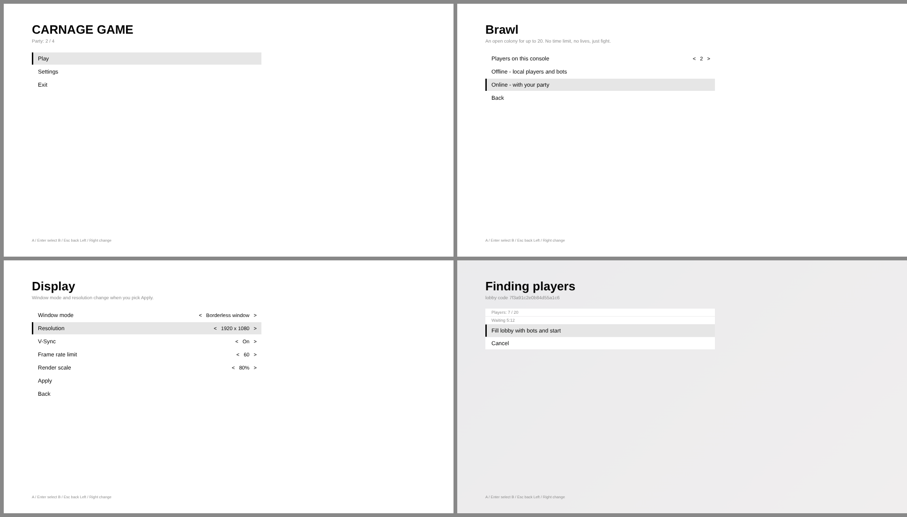

# Menüs (Platzhalter)



Weiß, schwarze Schrift, keine Assets. Alles ist Slate in C++ (`Game/Source/FightGame/Public/FightMenu.h`).
Damit laufen die Menüs ohne Editor-Arbeit und vom ersten Frame an mit Controller. Das echte Design kommt später
und ersetzt nur das Aussehen, nicht die Seiten.

**Steuerung:**

| Aktion | Controller / Tastatur |
|---|---|
| Bewegen | Steuerkreuz oder linker Stick, Pfeiltasten |
| Auswählen | A / Enter |
| Zurück | B / Esc |
| Wert ändern | Links/Rechts |
| Pause im Match | Start / Esc |

Maus geht auch.

**PlayStation-Controller:** DualSense (auch Edge) und DualShock 4 gehen auf Windows nativ, per USB und Bluetooth.
- Das Plugin `Game/Plugins/PlayStationPads` liest sie direkt per HID und meldet sie Unreal wie ein Xbox-Pad.
- Die Belegung geht nach Position: ✕ unten, ○ rechts, □ links, △ oben. Options öffnet die Pause.
- Anstecken mitten im Match geht. Bis zu 4 Pads werden erkannt.
- DS4Windows bitte schließen, sonst kommt jede Taste doppelt an.
- Rumble, Lightbar und adaptive Trigger kommen später.

## Seiten

```
Title ─┬─ Play ─┬─ 1v1 / 2v2 / Brawl / Custom ─┬─ Players on this console (1–4)
       │        │                              ├─ Rules (nur Custom)
       │        │                              ├─ Offline – lokale Spieler + Bots
       │        │                              └─ Online – Quick Match (bzw. mit Party)
       │        └─ Play with a friend ── Code erstellen / Code eingeben / Party verlassen
       ├─ Settings ─┬─ Display   Fenstermodus, Auflösung, V-Sync, FPS-Limit, Render-Scale, Apply
       │            ├─ Graphics  Preset, 8 Einzelwerte, automatisch erkennen
       │            ├─ Audio     Master, Musik, Effekte, Stimmen, im Hintergrund stumm
       │            ├─ Controls  Deadzone, Kamera-Tempo, Kamera invertieren, Vibration
       │            ├─ Online    Name, Input-Delay, Frame-Anzeige
       │            └─ Reset to defaults
       └─ Exit ── Quit? Ja/Nein

Lobby-Screen (online, bis das Match startet):
  Spieler x / y, Wartezeit, Bots auffüllen (ab 5:00), Cancel
Pause (im Match): Resume, Settings, Leave match
```

## Technik

- **Ablauf:**
  - `UFightOnline` ist ein GameInstance-Subsystem und überlebt den Levelwechsel. Es hält die Menüauswahl
    (`FFightMatchRequest`), den EOS-Login und die Party.
  - „Start“ lädt die Map neu. Der GameMode sieht den Request und spawnt den Director.
  - „Leave“ löscht den Request und lädt wieder. Dann zeigt der GameMode das Title-Menü.
- **Settings:**
  - Gespeichert in `UFightUserSettings` (Unterklasse von `UGameUserSettings`), also in der
    `GameUserSettings.ini` des Spielers, nicht in der Projekt-Config.
  - Video läuft über die Engine-eigenen Scalability-Werte.
- **Audio:** Musik, Effekte und Stimmen werden schon gespeichert. Sobald es Sounds gibt, hängen sie an
  Sound-Klassen. Master wirkt jetzt schon.
- **Pause:** Offline hält das Match an. Online läuft es weiter (geht bei Rollback nicht anders), und der
  Spieler, der das Menü offen hat, steht still.
- **Ohne Menü starten:** `Debug → bSkipMenu` in den Project Settings startet direkt das dort beschriebene Match,
  praktisch im Editor.
